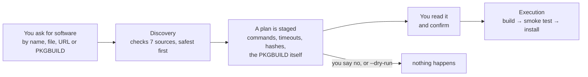
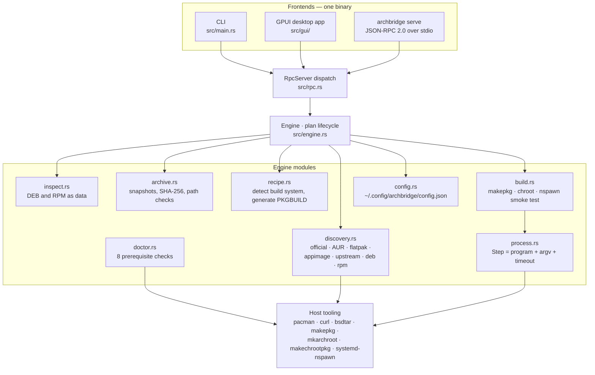
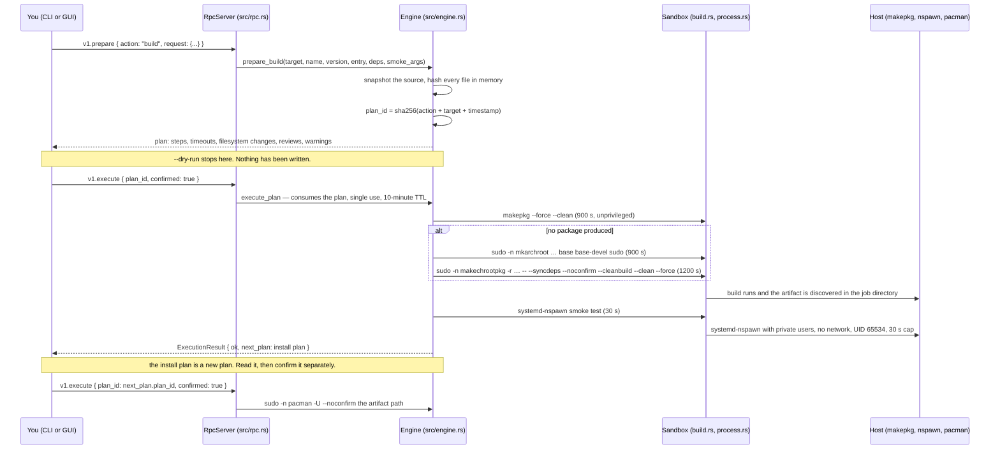
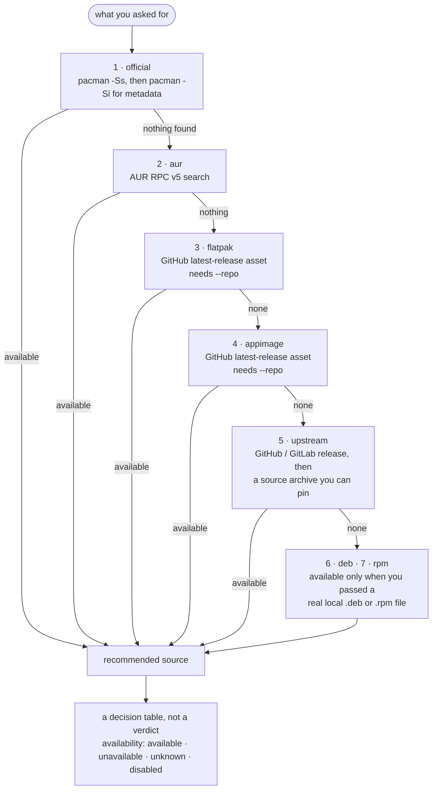

<div align="center">
<a id="top"></a>


<h1>ArchBridge</h1>

[](https://github.com/Zul-Qarnain/archbridge/actions/workflows/ci.yml)


<br>


<!-- TODO: replace the logo above with a real banner image, e.g. assets/banner.png -->

**ArchBridge finds the safest way to install a piece of software on Arch Linux — then shows you every command, hash and PKGBUILD it intends to run, and does nothing until you say yes.**

*One Rust binary: `archbridge gui`, `archbridge search`, `archbridge serve`.*

</div>

---

<a id="thirty-seconds"></a>
## ⏱️ Understand it in 30 seconds

You want a program on Arch. It is not in the official repos. What you find instead is a `.deb`, an AppImage, some random GitHub repo, and four blog posts telling you four different things.

ArchBridge turns that into one question, answered in order:

1. **Is it in the official repos?** (`pacman -Ss` / `pacman -Si`) — if yes, that's the answer.
2. **AUR?** (AUR RPC) — with the maintainer, the licence, and AUR's own *out-of-date* flag if it has one.
3. **A Flatpak or AppImage release asset?** — only if you point it at the upstream repo with `--repo`.
4. **Upstream source?** (GitHub / GitLab release or repo) — pinned by SHA-256.
5. **A `.deb` / `.rpm` on disk?** — read as **data**: metadata, file list, scripts shown but never executed.

Whatever it recommends, nothing happens until a **plan** is staged, displayed, and confirmed by you. The plan is single-use, expires after 10 minutes, and is voided the moment you change a preference.

> [!NOTE]
> ArchBridge is **pre-release** (`0.5.0-dev`). The engine and the GUI are real and run today, but the clean-chroot build and the runtime smoke test have **not** been validated on a disposable Arch VM — see [Status & limits](#status--limits). Treat it as a careful assistant, not an autopilot.

---

<a id="why"></a>
## 🧩 The problem it's for

- Arch has no `apt install ./file.deb`. The honest answer for a foreign package is "repackage it and know what you gave up", and almost nobody writes that down.
- The unsafe shortcuts are everywhere: `--skippgpcheck`, `curl | bash`, AUR helpers that source PKGBUILDs on your host, "just use the AppImage" with no idea what it touches.
- Once a tool runs a maintainer script as root, review is impossible — the interesting part already happened.
- So ArchBridge inverts it: **discovery is read-only, foreign packages are data, and mutation goes through one reviewed, hashed plan.**

---

<a id="see-it-working"></a>
## 👀 See it working

No screenshots are committed yet — this section is a placeholder with the shots it needs.

<table>
  <tr><td width="50%"><b>📷 Discover</b> — screenshot coming.<br><br>Seven sources, safest first, one row per source with its reason.<br><code>&lt;!-- TODO: add docs/screenshots/gui-discover.png --&gt;</code></td><td width="50%"><b>📷 Inspect</b> — screenshot coming.<br><br>A <code>.deb</code> opened as data: control fields, dependencies, and every maintainer script badged <code>NOT EXECUTED</code>.<br><code>&lt;!-- TODO: add docs/screenshots/gui-inspect.png --&gt;</code></td></tr>
  <tr><td width="50%"><b>📷 Build plan review</b> — screenshot coming.<br><br>The exact steps with timeouts, and the generated PKGBUILD in full, before any byte is written.<br><code>&lt;!-- TODO: add docs/screenshots/gui-build-plan.png --&gt;</code></td><td width="50%"><b>📷 Doctor</b> — screenshot coming.<br><br>Eight checks; an offline network reads <em>unavailable</em>, not <em>fail</em>.<br><code>&lt;!-- TODO: add docs/screenshots/gui-doctor.png --&gt;</code></td></tr>
</table>

Until then, a real CLI answer is one command away:

```bash
cargo run -- search hello
```

---

<a id="how-it-works"></a>
## ⚙️ How it works



- **Nothing mutates before `v1.execute`.** `--dry-run` prints the plan and stops; it never reaches execution.
- **Consent is bound to bytes.** Files are snapshotted and SHA-256 hashed at review time; execution uses that snapshot, not a second read of the original.
- **Foreign packages never run.** There is no code path that executes a DEB maintainer script or an RPM scriptlet — they are read, hashed and displayed.

<details>
<summary><b>For engineers:</b> architecture, plan lifecycle and the exact commands</summary>

### Architecture

Both frontends talk to the same in-process engine over the same JSON-RPC method names. The CLI uses `DirectRpcClient` ([src/main.rs](src/main.rs)), the GUI holds the server behind an `Arc<Mutex<RpcServer>>` ([src/gui/state.rs](src/gui/state.rs)), and `archbridge serve` exposes the identical server over newline-delimited stdin/stdout ([src/rpc.rs](src/rpc.rs)).



### Plan lifecycle



Full contract: [docs/IPC.md](docs/IPC.md) · security model: [docs/SECURITY.md](docs/SECURITY.md)

</details>

---

<a id="ladder"></a>
## 🪜 The safe-first ladder

The order is fixed in code ([src/discovery.rs](src/discovery.rs)); each source can be switched off in config, and the recommendation is simply **the first row that answers `available`**.



- **`unknown` is not `unavailable`.** A source that cannot be *reached* stays `unknown`; only a query that actually ran and came back empty is `unavailable`. A failed query is never promoted into a green light.
- **A disabled source says so** in its reason, rather than pretending to have searched.
- Flatpak and AppImage rows are *discovery of a release asset*: there is no Flathub query and no Flatpak/AppImage installation path in the engine.

---

<a id="safety-model"></a>
## 🛡️ Safety model — what it never does

| Guarantee | How it holds in the code |
|---|---|
| **Never executes a DEB maintainer script or RPM scriptlet** | `inspect.rs` only reads them and sets `executed: false`; there is no executor for them anywhere. `preinst` / `postinst` / `prerm` / `postrm` bodies are shown to you in full. |
| **Never runs an inspected binary** | inspection computes a SHA-256 of the file and lists payload paths; `needed_libraries` is never filled by running anything. |
| **Never executes a shell string built from your input** | every external command is a `Step { program, args, purpose, timeout_seconds }` ([src/process.rs](src/process.rs)). The only shell that ever interprets text is `makepkg` reading a PKGBUILD that appeared in your review. |
| **Never disables integrity or signature checks** | `--skipinteg`, `--skippgpcheck`, `--nodeps`, `--overwrite` and `SigLevel = Never` are absent from the source, and [tests/source_contract.rs](tests/source_contract.rs) fails the build if they appear. |
| **Never mutates before consent** | `v1.prepare` performs no writes, no config initialisation, no chroot creation; a `--dry-run` returns as soon as the plan is printed, so `v1.execute` is never reached. |
| **Never reuses, ages or shares a plan** | plans are removed from the pending map when executed, expire after `PLAN_TTL` = 10 minutes, and `confirmed: false` is refused outright. |
| **Never lets a preference change go unnoticed** | executing a `config.set` plan clears every other staged plan — your earlier review was of a different world. |
| **Never builds into your system** | work happens in `.archbridge/jobs/job-<hash>` under the working directory, with a job-local chroot; a system root is never a build target. |
| **Never escapes the sandbox at runtime** | the smoke test is `systemd-nspawn --private-users=pick --private-network --user 65534 -D <job test root>` with a 30-second timeout and no `--bind=`. |
| **Never trusts a downloaded byte it did not pin** | sources are snapshotted in memory and hashed; the published artifact is re-hashed after the copy to the output folder. |
| **Never lets a service be root** | `archbridge serve` runs as you; privileged steps are `sudo -n`, which fails closed instead of reading your RPC stdin as a password. |

> [!NOTE]
> **Residual risks are documented, not hidden.** Caps are coarse, not cgroups. Build-time dependency resolution has network reach. `bsdtar` still parses untrusted data. Shell-text classification of a PKGBUILD is a *hint*, not a proof of safety. Read [docs/SECURITY.md](docs/SECURITY.md) before pointing this at anything hostile.

---

<a id="features"></a>
## 🧰 What it does

| Capability | In plain words |
|---|---|
| **Discovery** · `search`, `info` | Asks all seven sources and returns a decision table with a reason per row — plus the metadata each source actually reports (licence, maintainer, size, AUR out-of-date flag). Missing fields stay missing. |
| **Foreign inspection** · `inspect` | Opens a `.deb` or `.rpm` as an archive: control fields, dependency strings, payload paths, desktop entries, systemd units, and every maintainer script — labelled *not executed*. |
| **Build recipe generation** · `build` | Detects the build system, generates a PKGBUILD, and hands it to you as text before anything runs it. Unrecognized project ⇒ a **blocked plan** that explains itself rather than a guess. |
| **Clean-ish builds** · `build` | Tries an unprivileged `makepkg --force --clean` first, then falls back to a job-local `mkarchroot` + `makechrootpkg` chroot. Toolchain output is kept in `build.log` next to the PKGBUILD. |
| **Runtime smoke test** | After a build, the artifact is unpacked into its own throwaway root and the entry binary is run inside `systemd-nspawn` with private users, no network, as UID 65534, for at most 30 s. A failing test yields `ok: false` and **no** install continuation. |
| **Staged install / uninstall** | `install <name>` on an official package plans `sudo -n pacman -S --needed --noconfirm`; a built artifact plans `pacman -U`; `uninstall <name>` plans `pacman -Rns`. Each is a plan you confirm. |
| **Doctor** | Eight prerequisite checks with an honest readiness rule (offline ≠ unready). |
| **Preferences** | Which sources are consulted at all, per-project repo URLs, and where finished packages are saved. |
| **Daemon** | `archbridge serve` — the same engine over newline-delimited JSON-RPC 2.0 for another program to drive. |
| **Desktop app** | Native GPUI window with the six views below, driven by the very same RPC methods. |

### Supported build systems

Detection order and templates live in [src/recipe.rs](src/recipe.rs).

| Detected from | Build system | What the generated PKGBUILD does |
|---|---|---|
| `CMakeLists.txt` | CMake | `cmake -B build` → `cmake --build build` → `cmake --install` |
| `Cargo.toml` + `Cargo.lock` + a binary target | Cargo | `cargo build --release --locked`, installs `target/release/<entry>` |
| `go.mod` | Go | `go build -trimpath -buildmode=pie -mod=readonly`; tells you the command names it did build if your `--entry` is wrong |
| `meson.build` | Meson | `meson setup --wrap-mode=nodownload` → `meson compile` → `meson install` |
| `package.json` with `scripts.build` **and** `bin`, plus `package-lock.json` | npm | `npm ci` → `npm run build`, symlinks the bin |
| same, with `yarn.lock` | Yarn | `yarn install --frozen-lockfile` → `yarn build` |
| `Makefile` containing an `install:` target and no `configure.ac` / `configure.in` | make | `make` → `make DESTDIR=$pkgdir PREFIX=/usr install` |
| a `.deb` / `.rpm` payload | Imported | Re-packs the reviewed payload; extracts it at package time, runs no scripts |
| anything else | Unsupported | **Blocked plan**, with the reason |

---

<a id="desktop"></a>
## 🖥️ The desktop app

`archbridge gui` opens one 1320×848 GPUI window, titled *"ArchBridge — Software Discovery & Packaging"*. There is no separate daemon to start and no Python anywhere in the build.

| View | What you can actually do |
|---|---|
| **Discovery** | Type a name, get the seven-row report, click a card to read the metadata that source reported, then *Prepare Install Plan* or *Build Plan*. |
| **Inspect (.deb/.rpm)** | Pick or type a foreign package (native file chooser via an XDG portal), read the header, then the sub-tabs **Maintainer Scripts**, **Dependencies**, **Desktop & Systemd**, **Libraries** — each script badged `NOT EXECUTED`. |
| **Build & Install** | Target → *Prepare Build Plan* → the review panel shows the plan id, summary, every step's purpose and the full PKGBUILD → *Execute Build* → on success, an install plan appears for a second, separate confirmation. Built packages land in the job directory, or in the output folder you chose. |
| **Uninstall Software** | Reads your explicitly installed packages from `pacman -Qe`, filters them locally, and stages a `pacman -Rns` plan behind an explicit confirmation dialog. |
| **Doctor Health** | Runs `v1.doctor` and renders pass / offline / fail per check. Before you run it the list is empty on purpose — a health check shown before measuring would be a claim about your machine. |
| **Settings & Preferences** | Seven source toggles, the output folder, theme, and *Invalidate Sudo / Clear Password*. Toggles are only written through a plan, per key. |

**Themes:** `Dark`, `Midnight` (true-black) and `Light`, switchable from the top bar or Settings ([src/gui/theme.rs](src/gui/theme.rs)). They are in-memory only and reset to `Dark` on launch.

Privileged actions prompt for your administrator password in-app; it is written to `sudo -S` and zeroed afterwards, never stored on disk. Settings also offers an opt-in fix for hosts where `pam_fprintd` makes `sudo` wait for a finger before serving the password — it comments that line out in `/etc/pam.d/sudo` and keeps a numbered backup.

> [!NOTE]
> The GUI is deliberately **narrower than the CLI**: it sends no `options`, so version, entry binary, dependencies and smoke-test arguments are CLI-only today. It also draws a few things it does not measure — see [Status & limits](#status--limits).

---

<a id="install"></a>
## 📦 Install

There is no package for Arch yet, and no AUR recipe. Build from source:

```bash
git clone https://github.com/Zul-Qarnain/archbridge
cd archbridge
cargo build --release
./target/release/archbridge --help
```

Or install it into your Cargo bin directory:

```bash
cargo install --path .
```

The repository's [Release workflow](.github/workflows/release.yml) bundles `archbridge-<tag>-linux-x86_64.tar.gz` plus a `.sha256` when a `v*.*.*` tag is pushed; the current `main` is `0.5.0-dev` and is ahead of any tag, so **build from source** to get what this README describes.

[assets/archbridge.desktop](assets/archbridge.desktop) is provided for desktop entries (`Exec=archbridge gui`); installing it system-wide is left to you.

### Prerequisites

For the **engine** (only what you actually exercise needs installing):

| Needed for | Binaries |
|---|---|
| Everything | `pacman`, `sudo`, `coreutils` (`which`), `curl`, `bsdtar` |
| Discovery of official packages | `pacman` sync databases |
| Building | `base-devel` (`makepkg`), a C compiler (`gcc`) |
| The clean-chroot fallback | `devtools` (`mkarchroot`, `makechrootpkg`) |
| The runtime smoke test | `systemd-nspawn` |

For the **build of the GUI binary**, the app links against GPU/X11/Wayland libraries; CI installs `libxcb1-dev`, `libxkbcommon-dev`, `libxkbcommon-x11-dev` and `pkg-config` before `cargo build` — on Arch those libraries ship under the same names without the `-dev` suffix.

ArchBridge never installs prerequisites for you. `archbridge doctor` tells you what is missing.

---

<a id="usage"></a>
## 🧪 Use it

Every flag below is parsed in [src/main.rs](src/main.rs); unknown flags are a usage error rather than a silently ignored typo.

```bash
# 1 · Ask what is safe
archbridge search hello
archbridge info firefox
archbridge search my-tool --repo https://github.com/me/my-tool

# 2 · Read a foreign package without running it
archbridge inspect ./vendor.deb

# 3 · Look at a build plan without writing anything
archbridge build ./my-app-1.2.3.tar.gz --name my-app --entry my-app --dry-run
archbridge build https://github.com/owner/tool --name tool --entry tool --dry-run
archbridge build ./checkout --name tool --version 1.4.0 --entry tool \
  --dependency openssl --smoke-arg --version --dry-run
archbridge build ./pkgdir/PKGBUILD --dry-run
archbridge build ./vendor.rpm --name vendor --entry vendor

# 4 · Run a plan you have read
archbridge build ./checkout --name tool --entry tool
archbridge install hello
archbridge install ./tool-1.0.0-1-x86_64.pkg.tar.zst
archbridge uninstall tool
archbridge test ./tool-1.0.0-1-x86_64.pkg.tar.zst --entry tool   # prints the plan only — see Status & limits

# 5 · Preferences and health
archbridge config get all
archbridge config set aur false
archbridge config set output_dir /home/me/packages
archbridge config set repo.my-tool https://github.com/me/my-tool
archbridge doctor

# 6 · Other surfaces
archbridge serve      # JSON-RPC 2.0 on stdin/stdout
archbridge gui        # native GPUI desktop app
```

- Build targets are: an existing directory, a path ending in `PKGBUILD`, a local `.deb`/`.rpm`, or an `https://github.com/…` / `https://gitlab.com/…` URL. A bare package name is **not** a build target, and an Arch `.db` repository index is refused as a package. Upstream sources are built from `.tar.gz`.
- `--yes` skips the confirmation prompt; it does **not** skip the plan, which is always printed first. `--dry-run` always wins over `--yes`.
- Declining a confirmation, or a blocked plan, exits **3** — so a script can tell "no" from "broken".

### Exit codes

| Code | Meaning |
|---|---|
| `0` | Query, dry-run, action or doctor-readiness succeeded |
| `1` | Operational error: build failure, failed smoke test, step failure, or `doctor` reporting not ready |
| `2` | Invalid arguments or usage |
| `3` | Blocked plan, or you declined the confirmation |

### Configuration

`$XDG_CONFIG_HOME/archbridge/config.json`, falling back to `~/.config/archbridge/config.json`.

| Key | Type | Default | Effect |
|---|---|---|---|
| `official`, `aur`, `flatpak`, `appimage`, `upstream`, `deb`, `rpm` | bool | `true` | Whether discovery consults that source |
| `repo.<name>` | string | — | Upstream repository URL used for the flatpak / appimage / upstream rows of `<name>` |
| `output_dir` | absolute path or empty | empty | Where a finished package is copied; empty keeps it in the job directory |

Writes go through a plan. Reading a key that does not exist is an error, not a silent default.

### Doctor

```bash
archbridge doctor
```

Eight checks: `pacman`, `base-devel`, `devtools`, `namespaces`, `disk_space`, `compiler`, `keyring` and `network`. `ready: true` requires the whole local toolchain — a present compiler is not a substitute for the `base-devel` meta-package. The network probe (HTTPS to `archlinux.org`) is deliberately **tri-state**: reachable → `pass`; offline or DNS dead → `unavailable`, which still leaves the system ready because inspection and local work proceed fine; an HTTP error or a TLS verification failure → `fail`, which marks the system **not ready**, because that pattern looks like an intercepting proxy. Exit code is `0` when ready, `1` when not.

### The RPC surface (`archbridge serve`)

`v1.capabilities` · `v1.search` · `v1.info` · `v1.inspect` · `v1.doctor` · `v1.config.get` · `v1.prepare` · `v1.execute`, plus `v1.authenticate`, `v1.deauthenticate`, `v1.sudo_advice` and `v1.optimize_sudo_auth`. `v1.prepare` takes actions `search`, `info`, `inspect`, `build`, `install`, `uninstall`, `test` and `config.set`. One JSON object per line; request frames over 1 MiB close the session; malformed JSON is `-32700`, a bad envelope `-32600`, an operation failure `-32000`.

---

<a id="dev"></a>
## 🛠️ Development and testing

| Command | What it does |
|---|---|
| `cargo build` / `cargo build --release` | debug / release binary (`lto`, `codegen-units = 1`, `strip`) |
| `cargo fmt --check` | formatting gate — CI fails without it |
| `cargo check --all-targets` | type-check tests and binaries too |
| `cargo test` | unit + integration suites |
| `cargo test --test source_contract` | the structural invariants listed [here](#safety-model) |
| `bash -n tests/acceptance.sh` | syntax-check the VM harness |

```bash
# keep the real config out of the way while testing
XDG_CONFIG_HOME=$(mktemp -d) cargo test
```

<details>
<summary><b>Acceptance testing on a disposable Arch VM</b></summary>

**Never run the privileged path on a machine you care about** ([docs/VALIDATION.md](docs/VALIDATION.md)).

```bash
ARCHBRIDGE_DISPOSABLE_ARCH_VM=yes bash tests/acceptance.sh                    # dry-run plans only
ARCHBRIDGE_DISPOSABLE_ARCH_VM=yes ARCHBRIDGE_RUN_BUILDS=yes bash tests/acceptance.sh   # + real builds and smoke tests
```

The harness exercises discovery and dry-run plans for an official package, an AUR candidate, an explicit GitHub source, and three build systems (CMake / Cargo / plain make). Those are **candidate acceptance projects, not recorded successful builds** — nothing in this repo claims they have passed.

`tests/foreign_formats.rs` needs real `./fixtures/vendor.deb` and `./fixtures/vendor.rpm`, which are **not committed**; without them those two tests pass vacuously rather than inspecting anything.

</details>

---

<a id="layout"></a>
## 🗂️ What's in this repo

| Path | Contents |
|---|---|
| `src/main.rs` | CLI parsing, exit codes, `DirectRpcClient` |
| `src/rpc.rs` | JSON-RPC 2.0 dispatch and the stdio loop |
| `src/engine.rs` | the `Plan` type, staging, TTL, single use, execution |
| `src/discovery.rs` | the seven sources and the recommendation |
| `src/inspect.rs` | DEB / RPM read-only inspection |
| `src/archive.rs` | in-memory snapshots, SHA-256, path and symlink rejection |
| `src/recipe.rs` | build-system detection and PKGBUILD templates |
| `src/build.rs` | makepkg, chroot fallback, `systemd-nspawn` smoke test |
| `src/doctor.rs` | prerequisite and network probes |
| `src/process.rs` | `Step` — argv + timeout, no shell strings |
| `src/config.rs` · `src/gui/` | preferences · the GPUI desktop app |
| `tests/` | `core`, `cli`, `doctor`, `foreign_formats`, `pkgbuild_shell`, `source_contract`, `acceptance.sh` |
| `docs/` | security, IPC, validation, decisions, releasing, development, baseline |
| `assets/` | logo (`archbridge.svg` / `.png`) and `archbridge.desktop` |
| `.github/workflows/` | `ci.yml` (fmt + test) and `release.yml` (tag → tarball + sha256) |

---

<a id="status--limits"></a>
## 🚧 Status & limits — read this before trusting it

Pre-release `0.5.0-dev`. Everything below is verified against the source, not guessed.

**Not yet validated**
- Real clean-chroot builds and runtime smoke tests **have not been run on a disposable Arch VM**. [docs/BASELINE.md](docs/BASELINE.md) marks both *implemented-unverified*, and [docs/VALIDATION.md](docs/VALIDATION.md) withholds the Phase-1 claim until that gate passes.
- Foreign-package inspection has not been cross-checked against `dpkg-deb` / `rpm` output, because neither is used — and no fixture packages are committed.
- No independent security review. [docs/SECURITY.md](docs/SECURITY.md) says so plainly: this is an unverified implementation, not a certification.

**Real gaps in the current code**
- **RPM inspection is shallow.** Name, version and architecture come from the *filename*; dependency strings and scriptlets are **not parsed**, so RPM reports carry an empty dependency list and an empty script list. ("Never executes a scriptlet" holds, but for RPM partly because no scriptlet is read.)
- **`needed_libraries` is always empty** — there is no `readelf`/`ldd` call, by design. The GUI's *Libraries* tab therefore shows nothing.
- **`archbridge test` does not run the container.** It stages and prints a `systemd-nspawn` plan pointing at a fixed `/tmp/disposable_test_root`, and executing it returns `ok: true` without launching anything. The smoke test that *does* run is the one inside a **build** plan. Use `build` to smoke-test.
- **A build can skip the clean chroot.** The unprivileged host `makepkg --force --clean` runs first; `mkarchroot` / `makechrootpkg` are a fallback used only when that produced no package.
- **A smoke test on a lone package is weak by design.** The test root contains that package only; if it has no dynamic loader, the test reports `passed: false` with an explanation instead of pretending.
- **Flatpak / AppImage are GitHub-release-asset lookups**, needing `--repo`. No Flathub query; no install path for either format.
- **The GUI shows a few strings it never measures:** `Disk: 47 GiB Free`, `Keyring: ✓ Verified`, `Active Chroot: None` in the status bar, a static *Engine Online* / *Ready* pill, and a per-card `Available` badge that does not read the engine's availability field. The source-filter dropdown and the search-history state are inert, and the review panel omits `plan.blocked` and `plan.warnings`.
- **Docs drift.** `PROJECT.md` still lists the GUI as "excluded" and quotes a chroot-first build order; `AGENTS.md` names themes that do not exist; `docs/IPC.md` mentions an `allow_unreviewed_scripts` request field that is not implemented. Code is the source of truth here.

**Bounds that do exist:** upstream archive downloads capped at 128 MiB, snapshots and hashes computed in memory, per-step timeouts (300–1200 s by stage, 30 s for the smoke test), 1 MiB RPC frames, file previews only under 10 kB of UTF-8.

---

<a id="roadmap"></a>
## 🗺️ Roadmap

| # | Milestone | Status |
|---|---|---|
| 1 | Phase-1 surface in Rust: discovery ladder, DEB/RPM inspection, recipes, plans, doctor, CLI, `serve`, GPUI app | ✅ Built |
| 2 | Structural invariants enforced in CI (`source_contract`), fmt + test gates, release workflow | ✅ Built |
| 3 | Disposable Arch VM acceptance: real official / AUR / upstream discovery, three build systems built, smoke-tested and installed; missing-`base-devel` diagnosis | 🔄 In progress — the harness exists, the run has not been recorded |
| 4 | Foreign `.deb` / `.rpm` repackage path reconciled with ADR-002: state what the omitted scripts cost, require separate test/install evidence | 🔄 In progress |
| 5 | Close the read-only gaps: RPM metadata and scriptlets parsed (not executed), a real library/dependency report, `archbridge test` actually executing | 🗓️ Planned |
| 6 | Reconcile the docs with the code (`PROJECT.md` GUI status, `AGENTS.md` theme list, build-order description) | 🗓️ Planned |
| 7 | GUI parity with the CLI: entry / version / dependencies / smoke args, warnings and blocked reasons surfaced, theme persisted | 🗓️ Planned |
| 8 | Phase 2+: local outcome history, foreign dependency mapping, `explain`, package signing, repository hosting, Dolphin integration | 🗓️ Planned, explicitly excluded from Phase 1 |

---

<a id="docs"></a>
## 📚 Docs

- [PROJECT.md](PROJECT.md) — architecture and Phase-1 scope · [AGENTS.md](AGENTS.md) — contributor/agent guide
- [docs/SECURITY.md](docs/SECURITY.md) — trust boundaries, enforced rules, residual risk
- [docs/IPC.md](docs/IPC.md) — the JSON-RPC contract · [docs/VALIDATION.md](docs/VALIDATION.md) — acceptance gates
- [docs/DECISIONS.md](docs/DECISIONS.md) — ADRs · [docs/RELEASING.md](docs/RELEASING.md) — release checklist · [docs/BASELINE.md](docs/BASELINE.md) — dated local snapshot, not a certification
- [docs/DEVELOPMENT.md](docs/DEVELOPMENT.md) · [UI_DESIGN.md](UI_DESIGN.md) · [CONTRIBUTING.md](CONTRIBUTING.md)

## 🤝 Contributing

Issues and PRs are welcome — open an issue first for anything that changes trust boundaries or privileged behaviour, and use the PR template's checklist. Run `cargo fmt --check` and `XDG_CONFIG_HOME=$(mktemp -d) cargo test` locally; keep packaging logic in the engine, never duplicated in a frontend; use a disposable VM for anything privileged. Security reports go privately, not through a public issue.

## 📄 License and disclaimer

MIT — see [LICENSE](LICENSE).

> ArchBridge is an independent, pre-release tool and is **not affiliated with or endorsed by Arch Linux**. It does not make your system safe on its own: it can show you an untrustworthy thing more clearly than a search engine can, but the judgement of every reviewed file stays **yours**. Do not run its privileged paths on a machine you value before [validation](docs/VALIDATION.md) has actually been performed, and never point it at hostile packages outside a disposable VM.

<div align="center">

**ArchBridge** · find the safest way in, then show every step · [back to top](#top)

</div>
